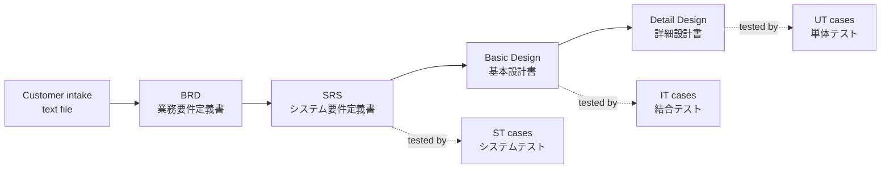
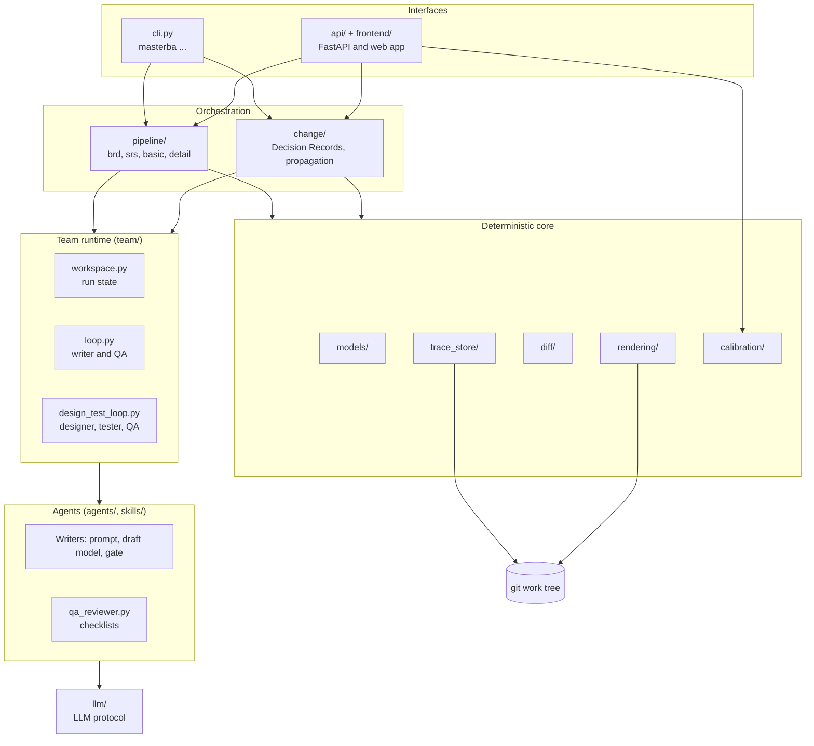

# 1. System overview

## 1.1 What MasterBA does

MasterBA turns a customer's requirement text into the set of deliverables a Japanese system
integrator produces in the V-model, and keeps them consistent when requirements change.

Every box is a versioned JSON document that is also rendered to an Excel workbook. The solid arrows
are the order in which documents are written; the dotted arrows are the V-model pairing between a
design level and its test level. A Decision Record (DR) later changes a requirement or a design
item and rewrites every document downstream of it.

## 1.2 The one idea that shapes everything

**A model proposes; code decides and records.** Language models write drafts and review them, but
they never choose an ID, never write a file, and never decide that a draft is good enough.

| Done by a model | Done by code |
|---|---|
| Cut requirements out of the intake | Check every citation points at real lines and quotes real text |
| Write SRS, design, test and detail items | Check every upstream item is covered and every reference exists |
| Review a draft against a checklist and list issues | Decide the verdict from the issues; downgrade issues that ask for no change |
| Propose a patch to a document for a DR | Validate the patch, apply it, keep untouched items identical |
| (optional) Suggest a column mapping for a customer's Excel sample | Assign every ID, write JSON, commit to git, render Excel, walk the trace graph |

The consequence is that storage, numbering, tracing and rendering behave the same whether a draft
came from a model, a test double or a person, and every automated test runs with a fake model.

## 1.3 Layers

| Layer | Package | Responsibility |
|---|---|---|
| Interfaces | `cli.py`, `api/`, `frontend/` | Parse a request, check who may make it, call the library, show the result. Neither interface holds business logic: both call the same functions, so git history is identical. |
| Orchestration | `pipeline/`, `change/` | Know the order of steps in a stage or a DR propagation, read upstream documents, assign IDs after a team succeeds, write results. |
| Team runtime | `team/` | Run the loop of writer, gate and reviewer; count rounds and tokens; keep the task list and mailbox; escalate; checkpoint and resume. |
| Agents | `agents/`, `skills/` | One module per role: its prompt (`agents/*.md`), its draft model (no IDs), and its gate. `qa_reviewer.py` is one stage-neutral reviewer; only the checklist in `skills/qa-review/checklists/` differs. |
| Model access | `llm/` | The `LLM` protocol: `generate(system, user, output, tool_name)` returns a validated object. `AnthropicLLM` forces a tool call so the answer is structured; `FakeLLM` serves tests. |
| Deterministic core | `models/`, `trace_store/`, `diff/`, `rendering/`, `calibration/` | The data contracts, the store, the trace graph, the structural diff, JSON to Excel, and template calibration. None of these calls a model except the optional refinement step in `calibration/`. |

Dependencies point downward only, with one exception: `calibration/` uses `agents/` and `llm/` for
its optional model step. `models/` imports nothing else from the package, and `trace_store/`,
`diff/` and `rendering/` import only `models/` and each other, never the pipelines or the team
runtime.

## 1.4 Rules that hold everywhere

1. **Models are the single source of truth.** Frozen Pydantic v2 types in `models/` define every
   entity; the files under `schemas/` are generated from them and a test fails if they drift.
2. **IDs are assigned by code and never change.** A new version of a document may not drop or
   revive an item ID (the ID Stability Rule, enforced in `add_document`). A removed item stays in
   the JSON with `status: removed`.
3. **One business action is one git commit.** Creating a requirement, a document, a trace link, a
   rendering or a run record is a commit made by `commit_paths`, which commits only the files it
   wrote. `git log` is the audit log.
4. **Nothing business-related is stored on escalation.** A stage that does not converge leaves its
   run record, drafts and transcripts, but no requirement, document or trace link.
5. **Documents are never overwritten.** Version `n+1` is a new file; the earlier version stays in
   the folder and in git. Re-rendering unchanged content makes no commit because the Excel output is
   byte-deterministic.
6. **Keys stay in the environment.** `ANTHROPIC_API_KEY` is read only from the environment; the
   dashboard and the files never see it.
7. **Text from outside is data, not instructions.** Intake text, upstream documents and drafts are
   passed to prompts as data, and every Excel cell is written as text, never as a formula.

## 1.5 What is not in the system

- No code generation yet (`specs/10-dev-extension.md` is a backlog spec).
- No UAT test document is produced; the `TEST_UAT` type exists in the model but no stage writes it.
- No database: the work tree is the database. Dashboard users and job records are small files under
  `.masterba/` and are not business data.
- No shared multi-machine state: a checkpoint of an escalated run stays on the machine that made it.
