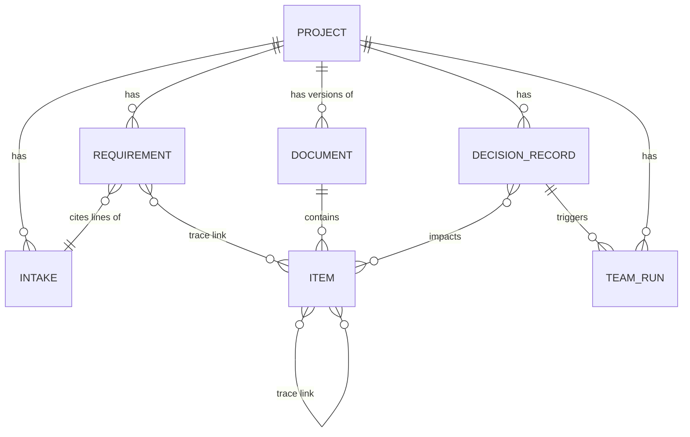
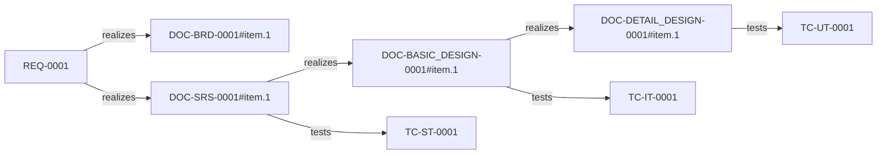

# 2. Data model and storage

MasterBA keeps no database. Every entity is a JSON file inside a git work tree, and every change
to those files is a commit. This document lists the entities, how they are named, where they live,
and how the trace graph is built from them.

## 2.1 Entities



| Entity | Model (`models/`) | Meaning |
|---|---|---|
| Project | `ProjectConfig` | Settings of one project: company, document language, round limits, token budget, propagation mode, dashboard roles |
| Intake | plain text | The customer's text, stored once and never changed |
| Requirement | `RequirementItem` | One business need: `source_ref` (intake lines), `text`, `category`, `status` |
| Document | `Document` | Metadata of one version of a deliverable: type, `version`, status, `template_id`, `content_ref`, `render_ref` |
| Item | `PayloadItem` subclasses | One numbered row of a document's content; see 2.3 |
| Trace link | `TraceLink` | `from_id`, `to_id`, `link_type` |
| Decision Record | `DecisionRecord` | A change request: trigger, description, impacted items, affected documents, status, approver |
| Team run | `TeamRun` | The summary of one stage execution: stage, trigger, status, rounds, issues, tokens, escalations |
| Question | `Question` | A point only the customer can settle, with its status and, once answered, the answer and the Decision Record that fixed it ([document 7](07-customer-questions.md)) |
| Template | `TemplateDefinition` | An Excel layout: sheet map, cell bindings, validation rules |

## 2.2 Identifiers

All identifiers are strings with a fixed pattern (`models/ids.py`). Code assigns them; no model
output contains one.

| Entity | Pattern | Example | Unique within |
|---|---|---|---|
| Project | `PRJ-###` | `PRJ-001` | the work tree |
| Requirement | `REQ-####` | `REQ-0003` | a project |
| Document | `DOC-<TYPE>-####` | `DOC-SRS-0001` | a project |
| Item | `<DOC_ID>#item.<n>` | `DOC-SRS-0001#item.5` | a document |
| Test case | `TC-<LEVEL>-####` | `TC-UT-0007` | a project |
| Decision Record | `DR-####` | `DR-0002` | a project |
| Team run | `RUN-####` | `RUN-0005` | a project |
| Question | `Q-####` | `Q-0007` | a project |

`<TYPE>` is one of `BRD`, `SRS`, `BASIC_DESIGN`, `DETAIL_DESIGN`, `TEST_IT`, `TEST_ST`, `TEST_UT`,
`TEST_UAT`. `<LEVEL>` is `UT`, `IT`, `ST` or `UAT`.

**ID Stability Rule.** Once an ID exists it is never reused and never changes meaning. `add_document`
compares a new version with the previous one and raises `IdStabilityError` if an item is missing or
if a removed item comes back to life. Items are numbered by position inside their document in the
order the model returned them (`assign_ids`, `assign_basic_ids`), and later versions append new
numbers. This rule is what makes impact analysis trustworthy: a DR names `DOC-SRS-0001#item.3`, and
that reference means the same thing in every version.

## 2.3 Document content

A document is stored as `{"document": <Document>, "content": <payload>}` in one file. The payload
depends on the type:

| Document type | Payload | Item fields (besides `item_id` and `status`) |
|---|---|---|
| `BRD` | `BrdContent` | `requirement_id`, `title`, `description`, `scope` (in or out), `source_ref` |
| `SRS` | `SrsContent` | `requirement_id`, `kind` (functional or non-functional), `statement`, `acceptance_hint`, `derives_from` |
| `BASIC_DESIGN` | `BasicDesignContent` | `kind` (function, screen, interface, data entity), `name`, `description`, `realizes` |
| `DETAIL_DESIGN` | `DetailDesignContent` | `kind` (module, processing step, DB table, API), `name`, `spec`, `refines` |
| `TEST_IT`, `TEST_ST`, `TEST_UT` | `TestSpecContent` | per case: `test_id`, `level`, `precondition`, `input`, `steps`, `expected`, `verifies`; plus a list of `exclusions` (item reference and reason) |

`add_document` also checks that the payload fits the type, the version is exactly the previous
version plus one, `content_ref` is the conventional path, every item ID starts with the document's
ID, IDs are unique, and test cases have the level of their document.

## 2.4 Trace links

A trace link points from the upstream thing to the downstream thing. The current stages create two
link types; the enum also defines `verifies`, `derives_from` and `implements`, which no stage uses
yet.

| Link | `link_type` | Created by |
|---|---|---|
| Requirement to BRD item | `realizes` | BRD stage |
| Requirement to SRS item | `realizes` | SRS stage |
| SRS item to Basic Design item | `realizes` | Basic Design stage |
| Basic Design item to Detail Design item | `realizes` | Detail Design stage |
| Design item to its IT case; SRS item to its ST case; Detail item to its UT case | `tests` | the stage that wrote the test document |



All links are in one file, `traceability/links.json`. Links are only added, never deleted, so the
history of what once realised what stays in git.

### The graph

`trace_store/graph.py` builds a `networkx` directed graph on demand from three sources:

- the nodes: requirements, documents, items and test cases (a test case ID `TC-...` is an **alias**
  of its item reference, so the graph has one node per test case);
- **containment edges** from each latest document to its items;
- **trace edges** from `links.json`.

Queries (`query_impact`, `rtm`) walk only trace edges, never containment edges; otherwise changing
one item would appear to affect every sibling in its document. `query_impact(node, direction)`
returns every node reached downstream, upstream, or both, with its depth and link type.
`rtm(req_id)` returns every path from a requirement down to a test case: the requirements
traceability matrix.

## 2.5 Files on disk

A project lives under `projects/<project_id>/` inside the work tree. This is the real layout after
running all four stages on a small intake:

```text
<work tree>/
├── .gitignore                    # contains .masterba/
├── .masterba/                    # dashboard state, not business data (gitignored)
│   ├── users.json                #   local accounts (PBKDF2 hashes)
│   ├── secret                    #   session signing key
│   ├── uploads/                  #   intake files uploaded through the dashboard
│   └── jobs/<project>/<job>.json #   background job records
├── templates/
│   ├── default/<TYPE>.xlsx and <TYPE>.template.json
│   └── companies/<company>/...   # calibrated templates (used only after <TYPE>.confirmed exists)
└── projects/PRJ-001/
    ├── project.json              # ProjectConfig
    ├── intake/leave_management.txt
    ├── requirements/REQ-0001.json ... REQ-0005.json
    ├── json/
    │   ├── brd/DOC-BRD-0001.v1.json
    │   ├── srs/DOC-SRS-0001.v1.json
    │   ├── basic_design/DOC-BASIC_DESIGN-0001.v1.json
    │   ├── detail_design/DOC-DETAIL_DESIGN-0001.v1.json
    │   └── test_it/, test_st/, test_ut/   # one TestSpecContent document each
    ├── xlsx/<type>/DOC-...v1.xlsx         # rendered workbooks, same version numbers
    ├── traceability/links.json
    ├── decision-records/                  # DR-0001.json, DR-0001.impact.json, DR-0001.propagation.json
    ├── questions/Q-0001.json              # the ledger of customer questions
    └── runs/RUN-0005/
        ├── team-summary.json              # TeamRun
        ├── team-tasks.json                # task list of the run
        ├── mailbox.json                   # messages between roles
        ├── .gitignore                     # transcripts/ and checkpoint.json
        ├── checkpoint.json                # last validated drafts (gitignored, used by --resume)
        └── transcripts/                   # every model request and response (gitignored)
```

Version numbers are plain integers: a document written once is `v1`, and the first change makes
`v2` in a new file next to it. File names are `<DOC_ID>.v<version>.json` and `.xlsx`.

## 2.6 Git history as the audit log

Every store function that changes a file ends with `commit_paths(paths, message)`. It stages only
the files it wrote, and commits them only if something changed. The message format is
`<scope>(<project_id>): <action> <entity>`. The sequence below is the start of the real history of a
project after the BRD stage:

```text
project(PRJ-001): create
intake(PRJ-001): add leave_management.txt
req(PRJ-001): add REQ-0001
...
doc(PRJ-001): create DOC-BRD-0001 v1
trace(PRJ-001): link REQ-0001 -> DOC-BRD-0001#item.1
...
render(PRJ-001): xlsx DOC-BRD-0001 v1
run(PRJ-001): RUN-0001 done
```

| Scope | Action | Written by |
|---|---|---|
| `project` | `create` | `create_project` |
| `intake` | `add <file>` | `add_intake` |
| `req` | `add` or `update <REQ>` | `add_requirement`, `update_requirement` |
| `doc` | `create <DOC> v<n>` | `add_document` |
| `trace` | `link <from> -> <to>` | `add_trace_link` |
| `render` | `xlsx <DOC> v<n>` | `render_to_project` |
| `run` | `<RUN> done` or `escalated`, with ` (resumed)` after a resume | `Team.finish` |
| `question` | `add <Q>`, `answer <Q>`, `withdraw <Q>` | `trace_store/store.py` |
| `dr` | `create <DR>`, `approve <DR>`, `reject <DR>`, `close <DR>`, `propagate <DR>` (status becomes propagated), `propagate <DR> <DOC>` (progress after one document) | `change/lifecycle.py`, `change/propagate.py` |

A stage that finishes writes many small commits in a fixed order: requirements, document, trace
links, rendering, run record. A stage that escalates writes only the run record.

## 2.7 Reading the store from code

The functions the rest of the system uses are all in `trace_store/` and take a `ProjectStore`
(`root`, `project_id`, `path`):

| Need | Function |
|---|---|
| Open or create a project | `open_project`, `create_project` |
| Read a document and its payload | `get_document(store, doc_id, version=None)`, `latest_documents`, `document_versions` |
| Write a document | `add_document` (validates, then commits) |
| Requirements | `add_requirement`, `update_requirement`, `get_requirement`, `list_requirements` |
| Links and graph | `add_trace_link`, `get_trace_links`, `query_impact`, `rtm`, `known_nodes` |
| Decision Records | `add_decision_record`, `get_decision_record`, `list_decision_records`, `save_decision_record` |

Callers never build paths by hand; only the store knows the folder layout.
