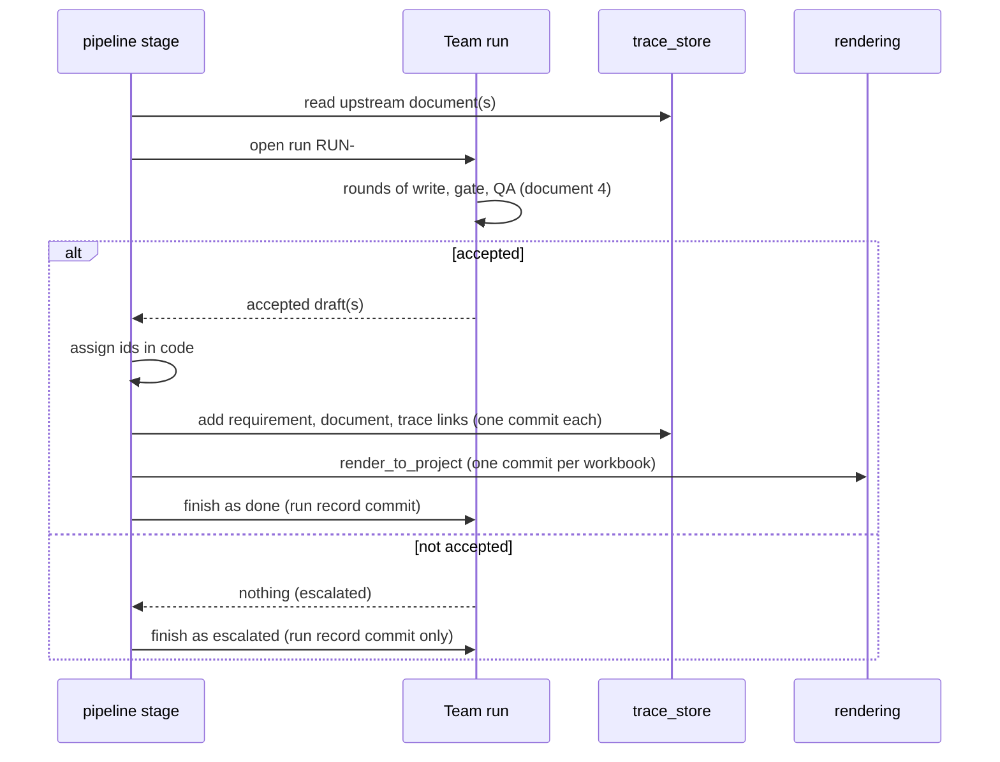

# 3. Pipeline data flow

This document follows the data. It starts with the whole path from intake to the last test
specification, then takes each stage in turn: what it reads, which agents work on it, which checks
it must pass, and exactly what it writes. How the agents inside a stage cooperate is the subject of
[document 4](04-team-runtime-control-flow.md).

## 3.1 End to end

```mermaid
flowchart TB
    IN[("intake/NAME.txt")] --> S1
    subgraph S1["Stage brd"]
        direction TB
        A1["requirements-analyst<br/>writes BrdDraft"] --> G1["gate: citations and quotes"]
        G1 --> Q1["QA: brd checklist"]
    end
    S1 -->|"REQ-####, DOC-BRD-0001<br/>realizes links"| BRD[("BRD v1")]
    BRD --> S2
    subgraph S2["Stage srs"]
        direction TB
        A2["srs-writer<br/>writes SrsDraft"] --> G2["gate: every in-scope requirement covered"]
        G2 --> Q2["QA: srs checklist"]
    end
    S2 -->|"DOC-SRS-0001<br/>realizes links"| SRS[("SRS v1")]
    SRS --> S3
    subgraph S3["Stage basic"]
        direction TB
        A3["basic-design"] --> A3b["basic-test-design"]
        A3b --> G3["gates: design covers SRS,<br/>tests cover design and SRS"]
        G3 --> Q3["QA: basic_design and tests checklists"]
    end
    S3 -->|"Basic Design, IT, ST<br/>realizes and tests links"| BD[("Basic Design v1<br/>IT and ST v1")]
    BD --> S4
    subgraph S4["Stage detail"]
        direction TB
        A4["detail-design"] --> A4b["unit-test-design"]
        A4b --> G4["gates: detail covers Basic Design,<br/>UT covers detail"]
        G4 --> Q4["QA: detail_design and unit_tests checklists"]
    end
    S4 -->|"Detail Design, UT<br/>realizes and tests links"| DD[("Detail Design v1<br/>UT v1")]
```



Each stage reads only the **latest stored version of the document before it**, never a draft and
never the model's memory. That is why the stages must run in order: `run srs` fails with
"DOC-BRD-0001 does not exist; run the brd stage first" if the BRD is missing.

## 3.2 What every stage does in the same four moves



The order of writes after acceptance is fixed: requirements (BRD only), documents, trace links,
Excel files, run record. A stage refuses to start if any document it would create already exists:
changing an existing document goes through a Decision Record
([document 5](05-change-management-flow.md)).

## 3.3 Stage `brd`: intake to BRD

| | |
|---|---|
| Command | `masterba run brd --project PRJ-001 --input FILE.txt` |
| Reads | the intake file (at most 200,000 characters); `project.json` for the document language |
| Stores first | `intake/<name>`, text normalised, one commit. A rerun with the same name needs `--reuse-intake`, and the text must be identical to what is stored. |
| Writer | `requirements-analyst` (`agents/requirements-analyst.md`, skill `brd-from-intake`). Input: the intake with numbered lines. Output: a `BrdDraft` of requirements, each with `start_line`, `end_line`, an `evidence_quote`, title, description, scope and category; plus open questions. **No IDs.** |
| Gate | `validate_draft`: every cited line range lies inside the intake; the evidence quote is a substring of those lines; titles are unique; the text is in the project's document language. Errors go straight back to the writer with no QA call. |
| QA | the `brd` checklist, reviewing the draft against the numbered intake |
| Assigns | `REQ-0001...` from the first number after the highest used; `DOC-BRD-0001#item.n` by position |
| Writes | `requirements/REQ-####.json` (one commit each), `json/brd/DOC-BRD-0001.v1.json`, one `realizes` link per requirement (requirement to BRD item), `xlsx/brd/DOC-BRD-0001.v1.xlsx`, the run record |
| Reports | `uncovered_lines` (intake lines no requirement cites) and the writer's open questions |

The requirement's `source_ref` is `intake/<name>#L<start>-L<end>`, so every requirement can be
traced back to the customer's own words.

## 3.4 Stage `srs`: BRD to SRS

| | |
|---|---|
| Command | `masterba run srs --project PRJ-001` |
| Reads | `DOC-BRD-0001` and the requirements, keeping only **active, in-scope** requirements. It refuses if none remain. |
| Writer | `srs-writer` (skill `srs-from-brd`). Output: an `SrsDraft`; every item says which `REQ-####` it `derives_from`, whether it is functional or non-functional, a statement and an optional acceptance hint. Open questions name the requirements they concern. |
| Gate | `validate_srs_draft`: every cited requirement is an in-scope BRD requirement; no duplicate statements; **every in-scope requirement is covered by at least one item**; language check |
| QA | the `srs` checklist; the upstream shown to QA is the list of BRD requirements |
| Assigns | `DOC-SRS-0001#item.n` by position |
| Writes | `json/srs/DOC-SRS-0001.v1.json`, one `realizes` link per (requirement, SRS item) pair, the workbook, the run record |

## 3.5 Stage `basic`: SRS to Basic Design and the IT and ST tests

This stage has two writing roles plus QA, because design and tests are written together: a missing
detail is found while the design can still change.

| | |
|---|---|
| Command | `masterba run basic --project PRJ-001 [--test-model M]` |
| Reads | `DOC-SRS-0001`, active items only. It refuses if the SRS has none. |
| Designer | `basic-design` (skill `basic-design-from-srs`). Output: a `BasicDesignDraft` of items of kind function, screen, interface or data entity, each listing the SRS items it `realizes`; plus `answers` to tester questions. |
| Tester | `basic-test-design` (skill `test-design-v-mapping`). Output: a `TestDraft` with `it_cases` (verify design items), `st_cases` (verify SRS items), `exclusions` (an item deliberately left untested, with a reason) and `questions` for the designer. |
| Design gate | `validate_design_draft`: every realised SRS item exists and is active; no duplicate name within a kind; **every active SRS item is realised by some design item**; language check |
| Test gate | `validate_test_draft`: every `verifies` reference resolves; **every design item has an IT case or an exclusion, and every SRS item has an ST case or an exclusion**; no item is both tested and excluded; questions refer to design items |
| QA | two reviews per round: the design against the `basic_design` checklist, then the tests against the `tests` checklist (upstream for the tests is the SRS plus the design) |
| Assigns | `DOC-BASIC_DESIGN-0001#item.n`; `DOC-TEST_IT-0001#item.n` with `TC-IT-0001...`; `DOC-TEST_ST-0001#item.n` with `TC-ST-0001...`. Exclusions go to the IT or the ST document by the prefix of the excluded reference. |
| Writes | three documents; links (`realizes` from each SRS item to each design item that realises it, `tests` from each verified item to its test case); three workbooks; the run record |
| Reports | `open_questions`: tester questions the designer could not settle, to be passed to the customer |

## 3.6 Stage `detail`: Basic Design to Detail Design and the UT tests

The detail stage is the same loop with different participants (it reuses `run_design_test_team`
unchanged), one level down the V.

| | |
|---|---|
| Command | `masterba run detail --project PRJ-001 [--test-model M]` |
| Reads | `DOC-BASIC_DESIGN-0001`, active items only |
| Designer | `detail-design` (skill `detail-design-from-basic`). Output: items of kind module, processing step, DB table or API, each naming the Basic Design items it `refines` |
| Tester | `unit-test-design` (skill `unit-test-design`). Output: UT cases verifying detail items, exclusions, questions |
| Gates | `validate_detail_draft` (every Basic Design item is refined, references resolve) and `validate_unit_test_draft` (every detail item has a UT case or an exclusion) |
| QA | the `detail_design` and `unit_tests` checklists |
| Writes | `DOC-DETAIL_DESIGN-0001`, `DOC-TEST_UT-0001`, `realizes` links from Basic Design item to detail item, `tests` links from detail item to its `TC-UT-####`, two workbooks, the run record |

## 3.7 A worked example

The numbers below come from a real run on a five-line synthetic intake ("Employees submit leave
requests and their manager approves or rejects them ...") with a gateway model. They show the size
of what each stage produces, not model quality.

| Stage | Result | Rounds | Written |
|---|---|---|---|
| `brd` | done | 1 | 5 requirements, `DOC-BRD-0001` with 5 items, 5 links |
| `srs` | done | 2 | `DOC-SRS-0001` with 5 items |
| `basic` | done | 1 | 5 design items, 6 IT cases, 5 ST cases, 3 open questions |
| `detail` | done | 2 | 10 detail items, 23 UT cases |

After the four stages the work tree holds 7 JSON documents and 7 workbooks, and the requirements
traceability matrix of `REQ-0001` has 13 paths. Two of them:

```text
REQ-0001 -> DOC-SRS-0001#item.1 -> DOC-BASIC_DESIGN-0001#item.1 -> DOC-DETAIL_DESIGN-0001#item.1 -> DOC-TEST_UT-0001#item.1
REQ-0001 -> DOC-SRS-0001#item.1 -> DOC-BASIC_DESIGN-0001#item.1 -> DOC-TEST_IT-0001#item.1
```

A test case ID `TC-...` and its item reference name the same node, so the paths end at the item.

## 3.8 What a stage result contains

Every stage returns the same `StageResult`, printed by the CLI as JSON and returned by the
dashboard as the job result.

| Field | Meaning |
|---|---|
| `stage`, `status`, `run_id` | which stage, `done` or `escalated`, and which run |
| `rounds`, `issues_raised`, `issues_resolved`, `tokens_used` | effort of the run |
| `advisory_issues` | QA remarks that did not block |
| `escalations` | why the run stopped (empty when done); the last QA feedback is appended |
| `document_id`, `document_ids`, `requirement_ids`, `xlsx` | what was written (empty when escalated) |
| `open_questions` | questions for the customer: the writer's own, those QA marked as needing the customer, and tester questions the designer could not answer |
| `uncovered_lines` | BRD only: intake lines that no requirement cites |

The CLI exit code is `0` for done and `3` for escalated.

`question_ids` and `reasked` complete the result: the ledger entries of this run, and how many of its questions repeat one already answered. The ledger is written after the run record ([document 7](07-customer-questions.md)).
