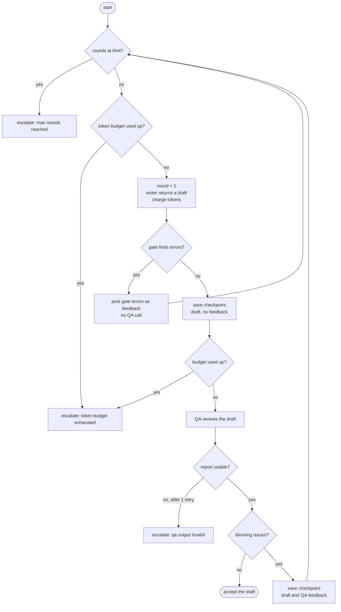
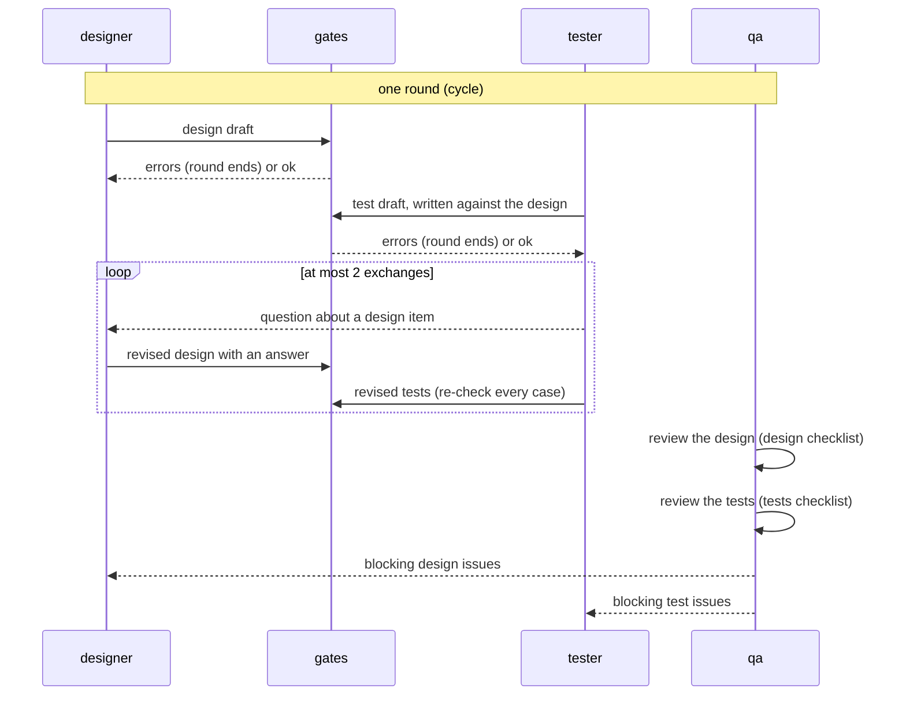
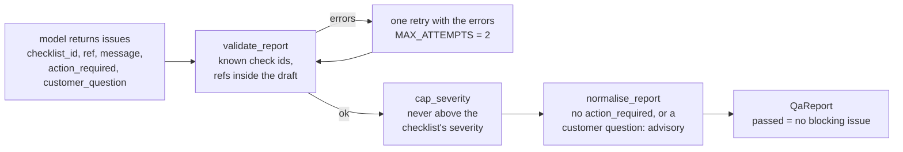
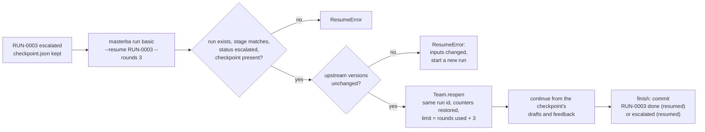

# 4. Team runtime control flow

[Document 3](03-pipeline-data-flow.md) showed what a stage reads and writes. This document shows
**who decides what while the stage runs**. A stage is executed by a *team run* (`RUN-####`): a few
agent roles that take turns, a set of deterministic gates, and one reviewer. The runtime in `team/`
owns the loop, the counters and the record of what happened; the pipeline owns what the accepted
result is turned into.

## 4.1 Roles and who owns what

| Role | Used in | Is | Writes (single-writer rule) |
|---|---|---|---|
| `writer` | `brd`, `srs`, DR propagation | one model call that returns a draft (or a patch) | `draft` |
| `designer` | `basic`, `detail` | one model call that returns a design draft | `design-draft` |
| `tester` | `basic`, `detail` | one model call that returns test cases, exclusions and questions | `test-draft` |
| `qa` | every stage | one model call that returns issues against a checklist | `qa-report` |
| gate | every stage | ordinary code, no model | feedback messages only |

`Team.write(role, artifact, value)` raises `SingleWriterError` if a role writes an artifact it does
not own. This keeps two roles from silently overwriting each other's draft. Each artifact is stored
as a numbered file in the run's `transcripts/` folder, together with every model request and response
(`RecordingLLM`).

The writer, designer and tester may use different models, and QA a stronger one: the CLI has
`--model`, `--test-model` and `--qa-model`. A reviewer stronger than the writer is recommended.

## 4.2 The writer and QA loop (`brd`, `srs`, DR propagation)

`run_writer_review` in `team/loop.py` is the whole loop. It is generic: the caller passes in `write`,
`gate` and `review` functions, so BRD, SRS and the revision of a document in a DR all use it.

Points to notice:

- **Gate errors cost no QA call.** A draft that cites a line that does not exist, or leaves a
  requirement uncovered, goes straight back to the writer. A round is spent, a review is not.
- **The gate comes first because it is cheap and exact.** QA is a model, so it is slower, costs
  tokens and can be wrong. It only sees drafts that already satisfy the structural rules.
- **A round is one writer call plus its review.** The default limit is 3 rounds, set by
  `team_max_rounds` in `project.json`, or per stage with `team_max_rounds_by_stage`.
- **`team_token_budget`** is optional. When set, the run stops before the next model call once the
  sum of input and output tokens reaches it.
- **Escalation returns nothing.** The loop returns `None`; the pipeline then writes only the run
  record. The escalation reasons are the stop reason followed by the last feedback, so a reader sees
  what was still unresolved.

## 4.3 The designer, tester and QA loop (`basic`, `detail`)

`run_design_test_team` in `team/design_test_loop.py` runs a **cycle** per round. The designer writes,
the tester writes against that design, and the tester may ask the designer a question before QA is
called.

Details that matter:

- **Questions are routed in code.** The tester's `questions` become mailbox messages of type
  `question` to the designer; the designer's `answers` become `answer` messages back. At most two
  exchanges happen in a cycle (`MAX_EXCHANGES`); a further question ends the cycle and is carried
  into the next round.
- **A question about an item the designer already answered cannot be settled inside the team.**
  The information is missing, so it stops blocking, is posted to the `customer` and is reported as an
  open question of the stage.
- **When the design changes, the tester is told to re-check every case,** with the answers attached.
- **QA reviews design and tests separately,** each against its own checklist, and the blocking issues
  of each go back only to the role that wrote that artifact.
- **The design is accepted only together with its tests.** One accepted result contains both; there
  is no partially accepted design.

## 4.4 What QA does, and what the code does to its answer

QA is one stage-neutral agent (`agents/qa-reviewer.md`). The stage is chosen by the checklist file
under `skills/qa-review/checklists/`: `brd`, `srs`, `basic_design`, `detail_design`, `tests`,
`unit_tests`. Each check has an id such as `TS-05`, a severity (`blocking` or `advisory`) and a text.

The model returns only a list of issues. Everything after that is code:

- **The verdict is computed.** `QaReport.passed` is true when no issue is blocking. The model never
  says "pass".
- **Blocking means "change this".** An issue that names no concrete change in `action_required`, or
  that only the customer can settle, is downgraded to advisory. Each downgrade is recorded as a
  mailbox note such as `[TS-05] DOC-TEST_IT-0001#item.2: downgraded (no action required)`. Customer
  questions are collected into `TeamRun.customer_questions` and end up in the stage's
  `open_questions`.
- **Facts the upstream leaves open are not defects.** The QA prompt (rule 6) and the `tests`
  checklist (TS-02, TS-05) tell the reviewer not to demand a case, a check or an exclusion for a
  detail the upstream material does not state, such as the event a deadline is counted from.
- **Advisory issues never block.** They are collected in `advisory_issues` and shown in the result.

## 4.5 The run workspace

`Team` is the state of one run, kept in memory and written to `runs/RUN-####/`:

| File | Content | Committed |
|---|---|---|
| `team-summary.json` | status, rounds, issues raised and resolved, tokens, escalations, customer questions, resume count | yes, at the end |
| `team-tasks.json` | the task list: `T-01...`, title, owner, status (todo, in progress, blocked, done), dependencies | yes, at the end |
| `mailbox.json` | messages: sender, recipient, type (`question`, `answer`, `feedback`, `done`), item reference, round, body | yes, at the end |
| `transcripts/NNN-round-R-<name>.txt` | every model request and response and every artifact | no (gitignored) |
| `checkpoint.json` | the last validated drafts, pending feedback, upstream versions, counters | no (gitignored) |

Summary, tasks and mailbox are committed once, by `finish`, as `run(PRJ-001): RUN-0005 done` or
`escalated`. A run cannot finish as `done` while a task of that attempt is not done; on escalation
the unfinished tasks are marked `blocked`.

Each task depends on the one before it, so the task list reads as the order of work: draft, review,
revise, review. The mailbox is the readable story of a run: each gate error, QA issue, question and
answer in order.

## 4.6 Escalation

A run escalates when it cannot produce an accepted result. The reasons it records:

| Reason | When |
|---|---|
| `max rounds reached (N)` | the round limit was hit with blocking issues or gate errors still open |
| `token budget exhausted (used/budget)` | the optional token budget was reached |
| `qa output invalid: ...` | QA's report was unusable twice |
| the last feedback | appended to every reason list, so the open problems are visible |

On escalation the pipeline stores no requirement, document, link or workbook. What remains is the
run record, the transcripts and the checkpoint. The next step is the owner's: resume the run, raise
a clarification Decision Record from it, or change the inputs.

## 4.7 Resume

A checkpoint is written after the gate passes and again after a QA review that blocks, so a resumed
run starts from the last good draft **and** the feedback that was pending, not from nothing.

Rules of a resume:

- Only an **escalated** run of the **same stage** resumes, and only if the inputs have the same
  versions as when it ran (`upstream` in the checkpoint, for example `{"DOC-SRS-0001": 1}`; for the
  BRD, the intake file name). If the SRS changed, the old drafts no longer fit.
- `--rounds N` adds N rounds to what the run has already used; the default adds the stage limit.
- Tokens, issue counts and the task list carry over. The earlier attempt's open tasks stay
  `blocked`, and the `done` check covers only the new attempt.
- The summary is rewritten and committed again, with ` (resumed)` at the end of the subject.
- The checkpoint is local to the machine: it is gitignored on purpose, so drafts that were never
  accepted do not enter the project history.

## 4.8 Why it is built this way

| Decision | Reason |
|---|---|
| Gates in code, before QA | structural rules (coverage, references, quotes) are exact; checking them with a model is slower and unreliable |
| QA issues must name an action | a blocking issue with no possible fix makes a run loop until the round limit |
| Verdict computed, never asked | a model asked for a verdict can contradict its own issue list |
| IDs assigned after acceptance | the writer cannot reuse, skip or renumber an ID, and a rejected draft never consumes one |
| Drafts and transcripts kept off git | git history stays a record of accepted business actions only |
| Same loop for BRD, SRS and DR revision | one tested loop; the stage supplies only `write`, `gate` and `review` |
