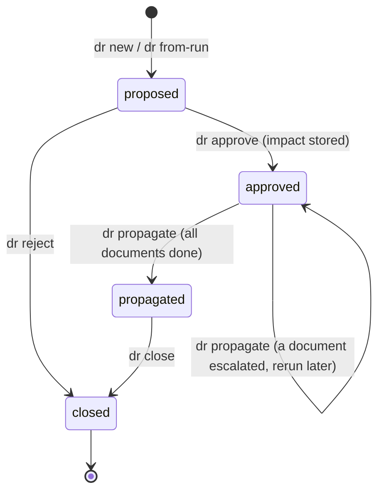
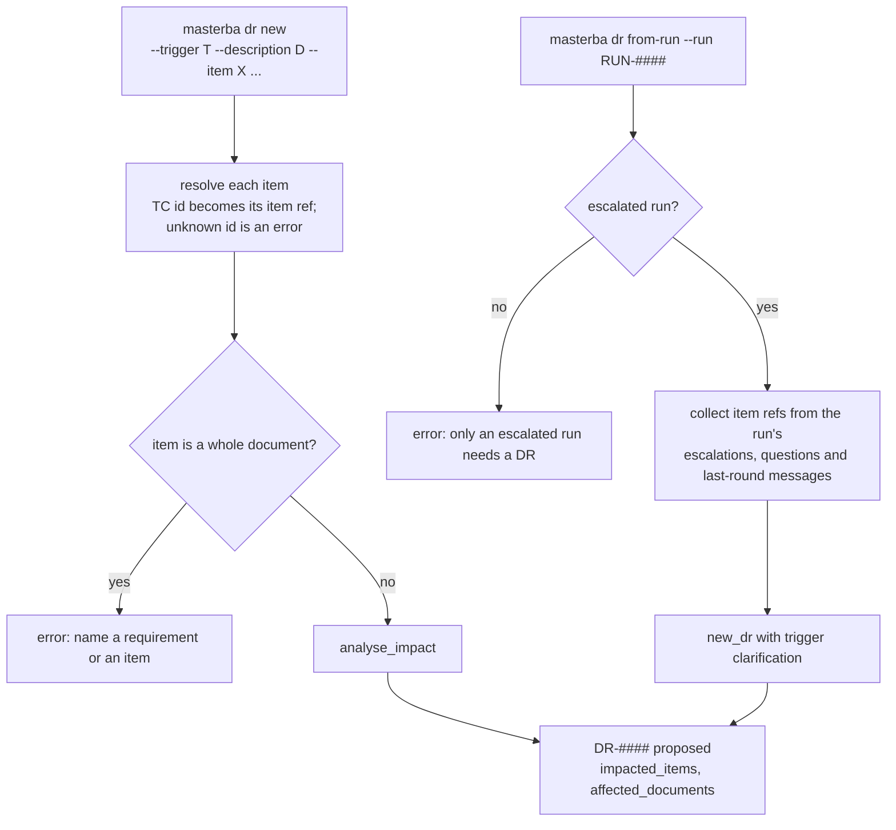
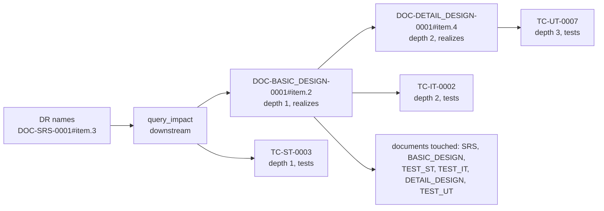
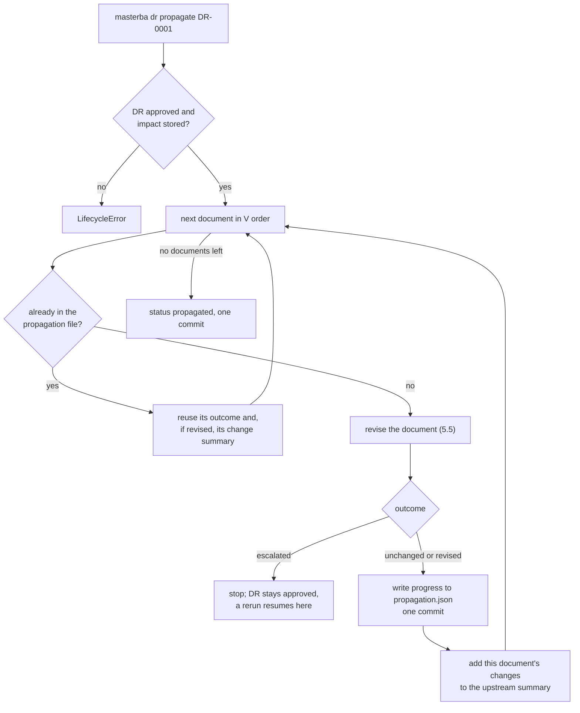
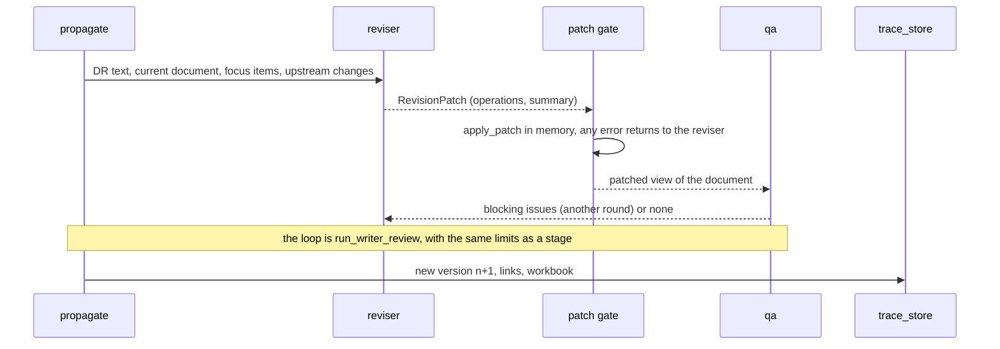
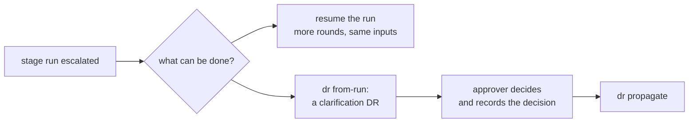

# 5. Change management flow

Once a document exists, it is never regenerated and never overwritten: `run brd` refuses if
`DOC-BRD-0001` exists. A requirement or design change instead goes through a **Decision Record**
(DR). The DR names what changes, the system finds everything downstream of it, a person approves,
and then each affected document is revised into a new version. This document follows that path.

## 5.1 Lifecycle

| Status | Meaning | Who moves it |
|---|---|---|
| `proposed` | A change was described; impact analysis ran and the affected documents are listed | anyone with approver role, or the CLI |
| `approved` | A named approver signed the decision; the impact analysis was recomputed and stored | an approver (`--approver` and `--decision` are required, `--rationale` is recorded) |
| `propagated` | Every affected document has been revised (or found unchanged) | `dr propagate`, automatically on success |
| `closed` | Finished, or rejected | `dr close` after propagation, or `dr reject` before approval |

The project setting `propagation_mode` is `manual_gate`: no document changes until a person has
approved. (`auto_low_risk` exists in the model but no code uses it yet.)

Each transition is one commit of the DR file, for example `dr(PRJ-001): approve DR-0001`.

## 5.2 Creating a DR

| Trigger | Meaning | Direction of impact analysis |
|---|---|---|
| `requirement_change` | the customer changed a requirement | downstream |
| `design_change` | the design must change | downstream |
| `clarification` | an answer to an open question (also what `from-run` creates); may have no items | downstream |
| `defect` | a test or review found a fault | **both** directions, because the cause may lie upstream |

`dr from-run` turns an escalated stage run into a clarification DR: the run's unresolved reasons
become the description and the item references it mentions become the impacted items. It is the
bridge between "the team could not decide" and "a person decides, then the system propagates".

## 5.3 Impact analysis (no model)

`analyse_impact` walks the trace graph ([document 2](02-data-model-and-storage.md), section 2.4)
from each impacted item along trace edges only.

The result is two things: the **entries** (each node reached, with depth and link type) and the
**documents** to revise, sorted in V order:

`BRD`, `SRS`, `BASIC_DESIGN`, `TEST_IT`, `TEST_ST`, `DETAIL_DESIGN`, `TEST_UT`

That order matters: a document is revised after everything it depends on, so each reviser can see
what the documents above it have already changed.

The analysis runs twice: when the DR is created, to show the proposer the size of the change, and
again at approval. The approval run is stored in `decision-records/DR-####.impact.json`, because the
graph can have grown in between and the approver signs what was shown.

## 5.4 Propagation

`propagate_dr` revises the affected documents one after another. For every document it opens an
ordinary team run (trigger `DR-####`) and uses the same writer and QA loop as the BRD and SRS stages
([document 4](04-team-runtime-control-flow.md), section 4.2).

Key properties:

- **Documents are processed in V order, one at a time.** The first escalation stops the whole
  propagation, because later documents would be revised against an upstream that did not settle.
- **A progress file makes it restartable.** After each document, `DR-####.propagation.json` records
  `{outcome, version, run_id}` in its own commit. Rerunning `dr propagate` skips documents already
  recorded and picks up at the one that escalated.
- **Upstream changes are passed down.** Each reviser receives the DR text and a summary of the
  changes already made above it (for example `DOC-SRS-0001 v2: DOC-SRS-0001#item.3 field_changed
  statement: 'old' -> 'new'`), so a design item changes consistently with the SRS item it realises.
- **The DR stays `approved` until every document is done.** Only then does it become `propagated`.

## 5.5 Revising one document

The model does not rewrite the document. It returns a **patch**, and code applies it.

The reviser is the `document-reviser` prompt (skill `document-revision`). A patch is a list of
operations:

| `op` | Fields | Effect |
|---|---|---|
| `update` | `item_id`, `fields`, `reason` | change named fields of an existing active item |
| `add` | `fields`, `reason` | append a new item; its number is the next free one in that document |
| `remove` | `item_id`, `reason` | set the item's `status` to `removed`; it is not deleted |

The patch gate, `validate_patch`, runs `apply_patch` in memory and reports every problem at once:

- **System-assigned fields cannot be set by the model.** `item_id`, `status`, `test_id` and `level`
  are rejected on `add` (the system numbers new items and test cases), and `update` may not change
  those or `requirement_id`.
- **Only fields the item type has can be changed,** and an `update` must change at least one.
- **Only active items can be targeted, and each only once per patch.**
- **Every reference an item holds after the patch must point at an active node** of the project
  (or at an item the same patch adds).
- **Items the patch does not touch stay identical,** so the structural diff between versions shows
  exactly what the DR changed and the ID Stability Rule holds.
- **An empty patch is a valid answer.** The document is then recorded as `unchanged`, with no new
  version, and QA is not called.

A BRD patch also moves the requirement it belongs to: adding a BRD item creates the next `REQ-####`
(its `source_ref` is the DR id), changing its description updates the requirement's text, and
removing it marks the requirement `removed`.

When QA accepts, the document is written as version `n+1`:

1. new or updated requirements;
2. `add_document` with `version = n + 1` and status `draft`, which re-checks the ID Stability Rule;
3. the links the new content implies that are not stored yet (`missing_links`; links are never
   removed);
4. the new workbook, `xlsx/<type>/DOC-...v<n+1>.xlsx`;
5. the run record, `RUN-#### done`.

## 5.6 Reviewing the result

`masterba dr diff DR-0001 [--structural-only]` compares, for every revised document, version `n` with
`n+1` item by item (`diff/changes.py`). Each change is `added`, `removed` or `field_changed`, and is
classified:

| Classification | Meaning |
|---|---|
| `structural_change` | the meaning may have changed |
| `reworded_only` | long text whose normalised form is very similar to the old one, with the same numbers |

A changed number is always structural, even when the text is 99% the same (100 to 1000). With
`--structural-only` the reworded changes are hidden, so a reviewer can look at what matters first.
The dashboard shows the same comparison.

## 5.7 Answering a customer question

A question in the ledger is answered with `question answer`: it creates a `clarification` DR, approves it with the answer as the decision and the person who recorded it as the approver, and saves the question as answered with the DR's id ([document 7](07-customer-questions.md)). Propagation stays a separate step. If an earlier attempt left the DR half done, running the answer again reuses it.

## 5.8 When a stage run escalated

Resuming spends more rounds on the same problem. A clarification DR is for when the problem is not
rounds but an open fact; the approver's decision is recorded with the DR and becomes input to the
revision.
