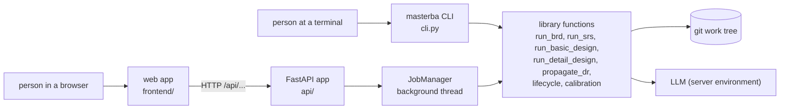
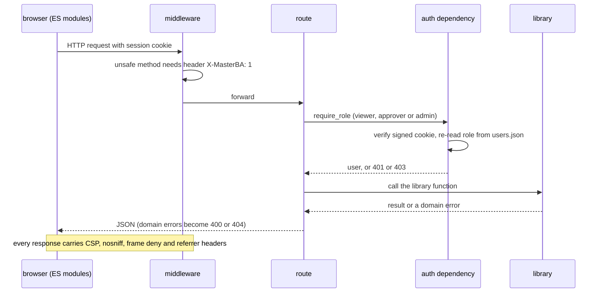
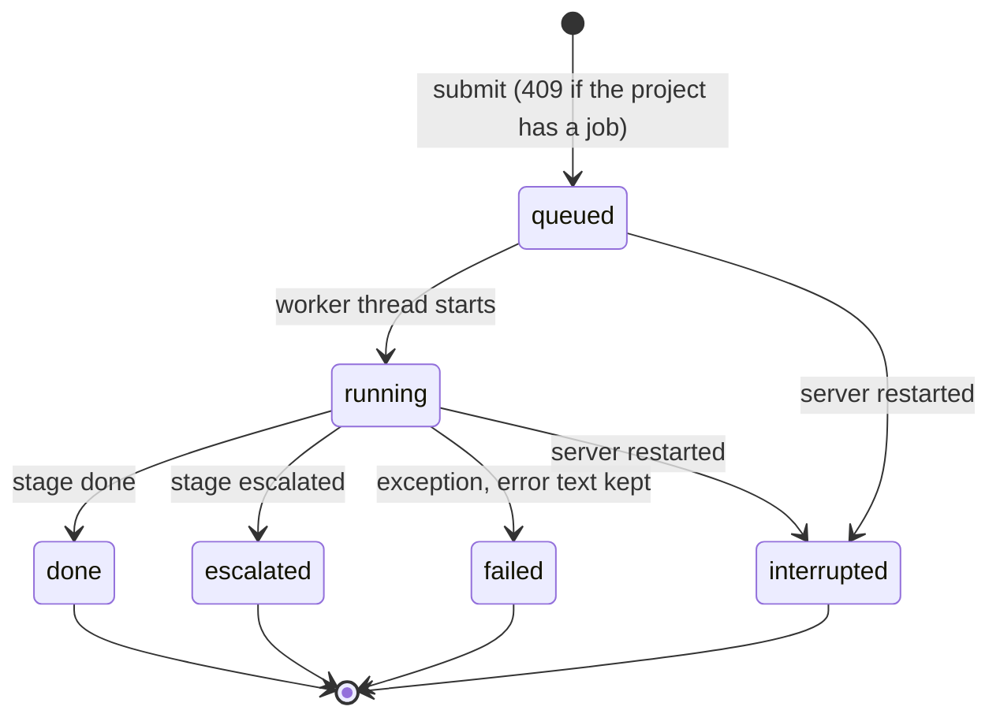
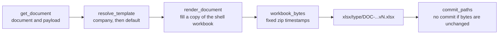
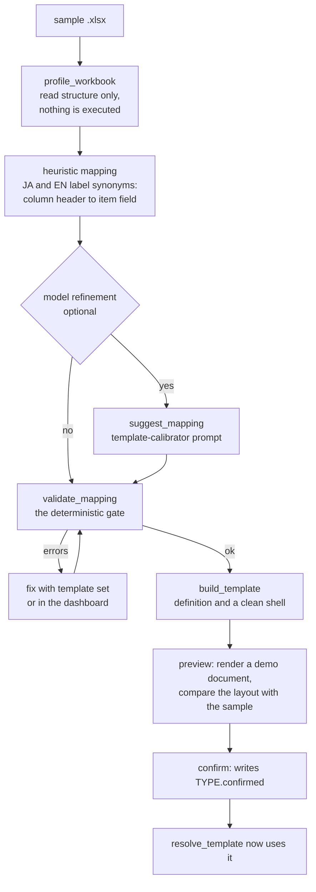
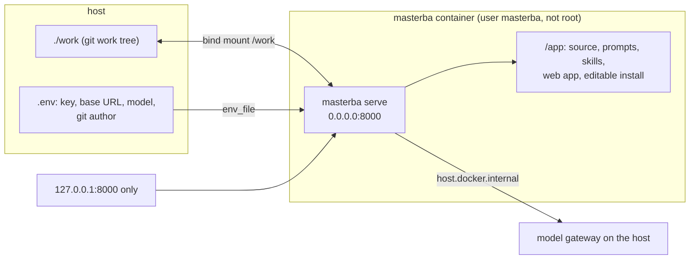

# 6. Interfaces and deployment

This document covers everything around the pipelines: how a person or a script starts work (the
CLI and the dashboard), how long work runs without blocking a browser (background jobs), how JSON
becomes Excel (rendering and template calibration), how the dashboard is protected, and how the
system is packaged and checked (containers and CI).

## 6.1 Two front doors, one library



The CLI and the API call **the same functions**, so a run started from the dashboard makes exactly
the commits a CLI run would. Nothing is implemented only in the dashboard.

## 6.2 The CLI

`masterba --root DIR <command>`. `--root` is the git work tree (default: the current directory); the
CLI refuses to run outside a work tree that can commit (only `doctor` runs without that check).

| Command | Purpose |
|---|---|
| `doctor [--init]` | check git, the work tree, the default templates, dashboard users and the model key; `--init` prepares an empty folder (git init, `.gitignore`, templates) |
| `init-project --project PRJ-001 [--language ja\|en] [--rounds STAGE=N]` | create a project and its `project.json` |
| `run brd --project P --input FILE` | intake to BRD |
| `run srs --project P` | BRD to SRS |
| `run basic --project P` | SRS to Basic Design with IT and ST tests |
| `run detail --project P` | Basic Design to Detail Design with UT tests |
| `dr new / from-run / approve / reject / propagate / close / list / show / diff` | Decision Records ([document 5](05-change-management-flow.md)) |
| `template calibrate / show / check / set / preview / confirm / unconfirm / list` | company templates from a sample workbook (6.6) |
| `question list / show / answer / withdraw` | the ledger of customer questions ([document 7](07-customer-questions.md)) |
| `user add / list / remove` | dashboard accounts |
| `serve [--host H] [--port N]` | run the dashboard (default `127.0.0.1:8000`) |

Every `run` command accepts `--model` (writer or designer), `--qa-model` (reviewer, default: the
same model), `--test-model` (tester, `basic` and `detail`) and `--resume RUN-#### [--rounds N]`. It
prints the stage summary as JSON and exits `0` when done, `3` when escalated, `1` on another error
(`2` for a bad command line).

The model key is read only from the environment: `ANTHROPIC_API_KEY`, and for a gateway
`ANTHROPIC_BASE_URL` and `MASTERBA_MODEL`.

## 6.3 The dashboard

### Request path



### Roles

Roles are ordered **viewer < approver < admin** and are re-read from `.masterba/users.json` on every
request, so changing a role takes effect at once without signing out.

| Role | May |
|---|---|
| viewer | read projects, documents, diffs, runs, jobs, the trace graph and DRs |
| approver | also upload an intake, start stage runs, and create, approve, reject, propagate and close DRs. The approver recorded on a DR is the signed-in user's name, not a field the client can set. |
| admin | also create projects and manage templates (the calibration endpoints) |

### Endpoints

Phase review routes (`/reviews`, `/stages/{stage}/approve`, `/stages/{stage}/reject`) are described in
[9. Phase review gates](09-phase-review-gates.md).


| Area | Endpoints (all under `/api`) |
|---|---|
| Session | `POST /login`, `POST /logout`, `GET /me` |
| Projects | `GET/POST /projects`, `GET /projects/{pid}`, `POST /projects/{pid}/intake` |
| Stage runs | `POST /projects/{pid}/stages/{stage}/run` (returns `202` and a job), `GET /projects/{pid}/jobs`, `GET /jobs/{job_id}` |
| Documents | `GET /projects/{pid}/documents`, `.../documents/{doc_id}`, `.../documents/{doc_id}/xlsx`, `.../documents/{doc_id}/diff` |
| Runs and activity | `GET /projects/{pid}/runs`, `.../runs/{run_id}`, `.../activity` |
| Trace | `GET /projects/{pid}/requirements`, `.../rtm/{req_id}`, `.../links`, `.../impact` |
| Questions | `GET /projects/{pid}/questions[?status=]`, `.../questions/{qid}`, `POST .../answer`, `POST .../withdraw` |
| Decision Records | `GET/POST /projects/{pid}/drs`, `.../drs/from-run`, `.../drs/{dr_id}`, `.../approve`, `.../reject`, `.../close`, `.../propagate`, `.../diff` |
| Templates (admin) | `GET /templates`, `POST /templates/{company}/{type}/calibrate`, `.../mapping`, `.../preview`, `.../confirm`, `.../unconfirm` |
| Health | `GET /health`, the only endpoint that needs no sign-in |

### Background jobs

A stage run can take minutes, far longer than a request. `POST .../run` therefore starts a job and
returns at once.



- **One job per project at a time.** A second submit gets `409` and a message.
- **Progress is a log.** The team runtime calls `emit` at the start of each round and when a run
  finishes; the job collects those lines (the last 200 are kept). The browser polls
  `GET /jobs/{id}` and shows the log, then the `result`, which is the same JSON the CLI prints.
- **Jobs survive a restart as files.** Each job is written to
  `.masterba/jobs/<project>/<job>.json` on submit, on start, on each log line and on finish. After a
  restart a job that was queued or running is shown as `interrupted`; the last 50 per project are
  kept. Whatever it had committed stays in git, and an escalated or interrupted stage can be resumed.
- **Models come from the server environment only** (`MASTERBA_MODEL`, `MASTERBA_QA_MODEL`,
  `MASTERBA_TEST_MODEL` and the key). The browser sends a stage name and options; it never sends or
  sees a key or a model setting.

### The web app

`frontend/` is plain ES modules with no build step: `app.js` starts it, `api.js` is the only place
that calls the server, `dom.js` builds elements, and `views/` has one module per screen (login,
overview, projects, activity, documents, trace, questions, DRs, templates). Text is inserted only as text nodes
and the CSP forbids inline script and style, so content from a model cannot run in the page.

## 6.4 Rendering: JSON to Excel

Rendering is deterministic and uses no model.



- **A template is two files:** `<TYPE>.xlsx` (the shell: styles, headers, an empty table area) and
  `<TYPE>.template.json` (a `TemplateDefinition`). Its `cell_bindings` have two kinds of entry:
  **header bindings** (a cell receives a value such as `$document.id`, `$document.version` or
  `$project.id`) and **table bindings** (a start row, one column per item field, an optional
  numbering column, an optional filter such as `kind = functional`, and optional value maps that
  translate an enum into the label used in that company's workbook).
- **The default set** is generated from one catalog (`rendering/catalog.py`) by
  `python -m masterba.rendering.shells`, and a test fails if the committed files drift from it.
- **Bindings are parsed into typed models when a template is loaded,** so a malformed template fails
  at load, not halfway through a render. Templates also carry a `max_cell_length` validation rule at
  Excel's cell limit.
- **Safety:** every string is written as text, never as a formula. Because the bytes are
  deterministic, rendering unchanged content makes no commit.
- **Which template:** for company `default`, the default set. For another company the calibrated
  template is used only if `<TYPE>.confirmed` exists next to it; otherwise the default is used and a
  warning is logged.

## 6.5 Where the code finds its files

The code locates prompts, skills and the web app relative to the source tree, not relative to the
work tree:

| What | Location | Used by |
|---|---|---|
| Agent prompts | `agents/*.md` | each agent module |
| Skills | `skills/<name>/SKILL.md` | the written task description of each agent |
| QA checklists | `skills/qa-review/checklists/*.toml` | `qa_reviewer.py` |
| JSON Schemas | `schemas/*.schema.json` | generated from `models/`, drift-tested |
| Default templates | `templates/default/` | rendering |
| Web app | `frontend/` | the `serve` command |

This is why the Docker image keeps the source at `/app` as an editable install.

## 6.6 Template calibration

A company template starts from a sample workbook the customer already uses. The aim is that
MasterBA's output looks like the company's own forms.



- Output goes to `templates/companies/<company>/` as `<TYPE>.xlsx`, `<TYPE>.template.json` and the
  draft mapping. **A calibrated template is ignored until `<TYPE>.confirmed` exists,** so a person
  always looks at the preview first.
- The model only proposes the mapping and cannot skip validation; the same gate checks the heuristic
  result and the model's result.
- Calibration is admin-only in the dashboard (`/api/templates`) and available as
  `masterba template ...` in the CLI.
- It has been verified on synthetic samples only; there is no real customer workbook yet.

## 6.7 Containers



| Piece | Detail |
|---|---|
| `Dockerfile` | multi-stage; the builder installs dependencies with uv from `uv.lock` (no dev tools); the final image is `python:3.11-slim` with git, a non-root user `masterba` (UID and GID are build arguments so files on the bind mount belong to the host user), `/work` as the working folder, entrypoint `masterba --root /work`, default command `doctor` |
| `compose.yaml` | one service; the port is published on `127.0.0.1` only because the dashboard has local accounts and no TLS; `.env` is read if present; the git author is passed as `GIT_AUTHOR_*` variables (the container has no git config); `host.docker.internal` reaches a gateway on the host; a health check calls `/api/health` |
| Secrets | the key lives in `.env` (gitignored) or the shell; the image holds none, and CI scans for it |
| First use | `docker compose run --rm masterba doctor --init`, then `docker compose run --rm masterba user add admin --role admin`, then `docker compose up` |

## 6.8 Continuous integration

`.github/workflows/ci.yml` runs on every push and pull request:

| Job | Runs | Checks |
|---|---|---|
| `quick` | always | `ruff check`, `ruff format --check`, `mypy src tests`, `pytest -m "not slow and not live"` |
| `full` | on `main` and on pull requests | all tests with the 80% coverage gate |
| `image` | on `main` and on pull requests | builds the image; runs `doctor --init` and `init-project` in it as a non-root user; checks the commit author; scans the image history and filesystem for a key or `.env` |

The `slow` marker is set per test module from measured durations, and the `live` marker (real model
calls, needs a key) is excluded everywhere in CI. Every automated test uses `FakeLLM`.

## 6.9 Running it, start to finish

```bash
uv sync                                         # install
uv run masterba --root work doctor --init       # prepare a work tree
export ANTHROPIC_API_KEY=...                    # key, from the environment only
uv run masterba --root work init-project --project PRJ-001 --language en
uv run masterba --root work run brd --project PRJ-001 --input intake.txt
uv run masterba --root work run srs --project PRJ-001
uv run masterba --root work run basic --project PRJ-001
uv run masterba --root work run detail --project PRJ-001
uv run masterba --root work user add admin --role admin
uv run masterba --root work serve               # dashboard on http://127.0.0.1:8000
```

If a stage exits with `3`, read `escalations` in its output, then either
`run <stage> --resume RUN-#### --rounds N`, or `dr from-run --run RUN-####` when the problem is an
open fact rather than too few rounds.
