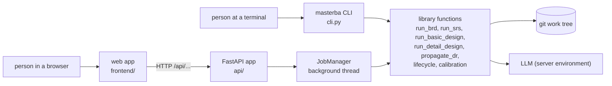
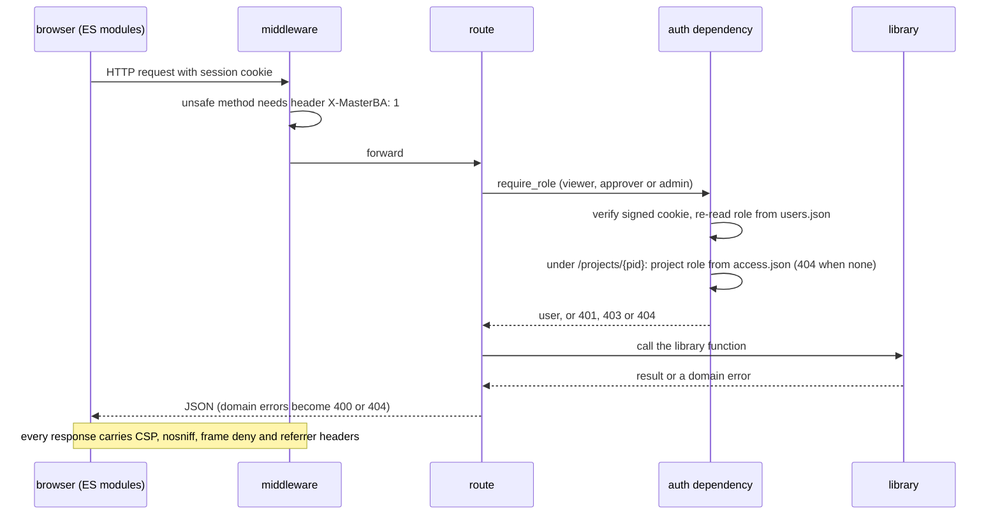
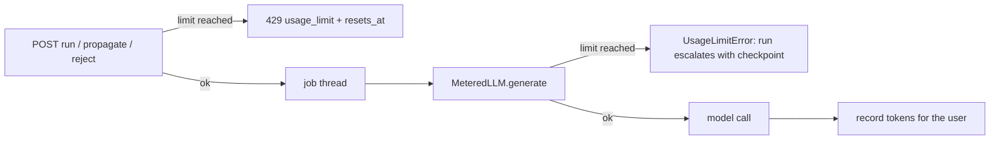
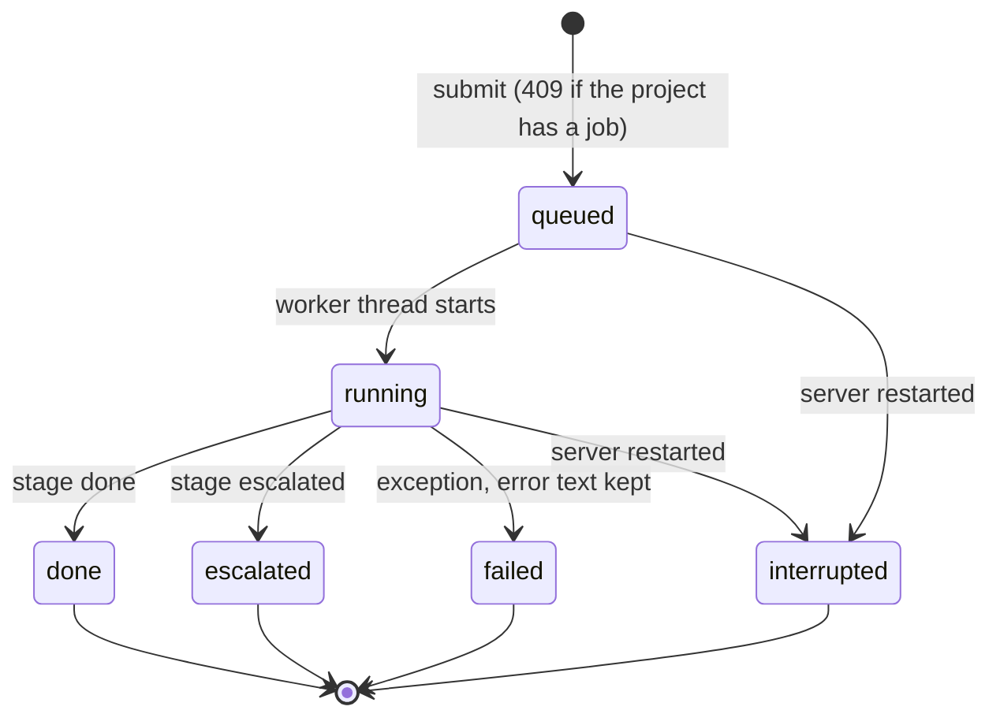
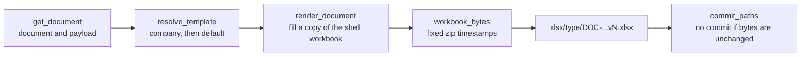
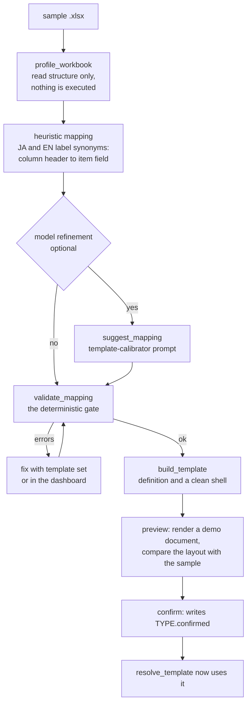
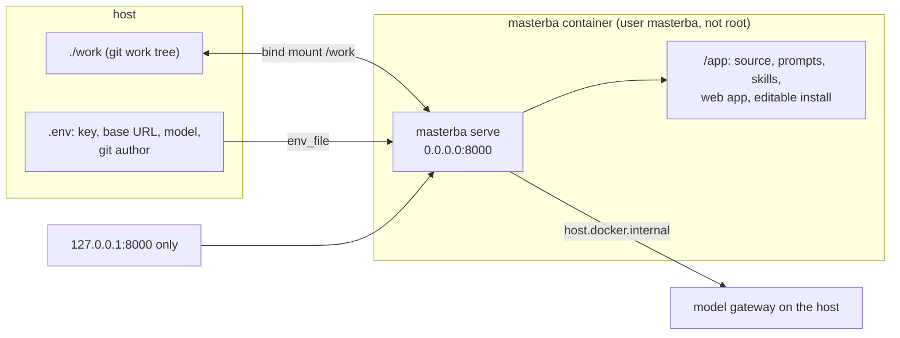

# 6. Interfaces and deployment

This document covers everything around the pipelines: how a person or a script starts work (the
CLI and the dashboard), how long work runs without blocking a browser (background jobs), how JSON
becomes Excel (rendering and template calibration), how the dashboard is protected, and how the
system is packaged and checked (containers and CI).

## 6.1 Two front doors, one library



The CLI and the API call **the same functions**, so a run started from the dashboard makes exactly
the commits a CLI run would. Nothing is implemented only in the dashboard.

## 6.2 The CLI

`masterba --root DIR <command>`. `--root` is the git work tree (default: the current directory); the
CLI refuses to run outside a work tree that can commit (only `doctor` runs without that check).

| Command | Purpose |
|---|---|
| `doctor [--init]` | check git, the work tree, the default templates, dashboard users and the model key; `--init` prepares an empty folder (git init, `.gitignore`, templates) |
| `init-project --project PRJ-001 [--language ja\|en] [--rounds STAGE=N] [--no-review-gates]` | create a project and its `project.json`; review gates are on unless turned off |
| `run brd --project P --input FILE` | intake (`.txt`, `.md`, `.docx`, `.pdf`, `.xlsx`) to BRD |
| `run srs --project P` | BRD to SRS |
| `run basic --project P` | SRS to Basic Design with IT and ST tests |
| `run detail --project P` | Basic Design to Detail Design with UT tests |
| `dr new / from-run / approve / reject / propagate / close / list / show / diff` | Decision Records ([document 5](05-change-management-flow.md)) |
| `template calibrate / show / check / set / preview / confirm / unconfirm / list` | company templates from a sample workbook (6.6) |
| `template sets / share / clone`, `project set-template / coverage / reissue` | the template library and a project's set (6.7) |
| `question list / show / answer / withdraw` | the ledger of customer questions ([document 7](07-customer-questions.md)) |
| `review status / list / approve / reject` | phase review gates ([document 9](09-phase-review-gates.md)) |
| `kb setup / add / list / replace / remove / reindex / search` | the project knowledge base ([document 8](08-knowledge-base.md)) |
| `user add / list / remove` | dashboard accounts |
| `serve [--host H] [--port N]` | run the dashboard (default `127.0.0.1:8000`) |

Every `run` command accepts `--model` (writer or designer), `--qa-model` (reviewer, default: the
same model), `--test-model` (tester, `basic` and `detail`) and `--resume RUN-#### [--rounds N]`. It
prints the stage summary as JSON and exits `0` when done, `3` when escalated, `1` on another error
(`2` for a bad command line).

The model key is read only from the environment: `ANTHROPIC_API_KEY`, and for a gateway
`ANTHROPIC_BASE_URL` and `MASTERBA_MODEL`. `MASTERBA_REQUEST_TIMEOUT` (seconds per request, default
180) and `MASTERBA_MAX_TOKENS` (output tokens per call, default 16000) set the request limits;
`MASTERBA_EMBED_MODEL` picks the embedding model of the knowledge base.

## 6.3 The dashboard

### Request path



### Roles and project access (spec 23)

Roles are ordered **viewer < approver < admin** and are re-read on every request, so a change takes
effect at once without signing out. There are two of them:

- The **global role** in `.masterba/users.json`: a viewer may open projects shared with them, an
  approver may also create projects (and owns them), an admin sees every project and manages users,
  limits and templates.
- The **project role** in `.masterba/access.json` (owner and members per project, not in git): the
  owner and global admins are `admin` in the project, a member is `viewer` or `approver`. Every
  route under `/api/projects/{pid}` checks the project role; a user with none gets `404`, so other
  people's projects are not revealed, and `GET /projects` lists only the user's own and shared
  projects. `GET /jobs/{id}` checks the job's project the same way.

| Project role | May |
|---|---|
| viewer | read the project: documents, diffs, runs, jobs, the trace graph, questions and DRs |
| approver | also upload an intake, start stage runs, answer questions, approve or reject phases, and create, approve, reject, propagate and close DRs. The name recorded on a DR or review is the signed-in user's, not a field the client can set. |
| admin (owner) | also change project settings (run token budget, propagation mode), members and the owner |

The first time `access.json` is read after an upgrade, every existing project goes to the first
admin (by name) and every other existing user becomes a member with their global role, so nobody
loses access. A project created later with the CLI goes to the first admin alone.

### Usage metering and limits (spec 23)

Every model the API creates for a job is a `MeteredLLM` (`llm/metered.py`) bound to the user who
started the job (`accounts/usage.py` `UserMeter`). Before each call it checks the user's limits;
after it, it records input and output tokens with project, job kind and model in
`.masterba/usage.sqlite3`. Two windows count, as in a Claude plan: `session` (5 hours) and
`weekly` (7 days), each starting at the first call after the previous one ended. Limits come from
the user's own entry in `.masterba/limits.json`, else its `default`, else
`MASTERBA_LIMIT_SESSION_TOKENS` / `MASTERBA_LIMIT_WEEKLY_TOKENS`, else no limit.



A run that hits the limit mid-way escalates like any failed model request and resumes after the
reset. The CLI is the operator and is not metered.

### Admin console (spec 24)

Accounts get a life cycle in `users.json`: `created`, `last_login`, `disabled` and
`sessions_after`. The session cookie carries the time it was issued (`name\nexpiry\nissued`), and
`deps.current_user` refuses a disabled user and any cookie issued before `sessions_after`, so
*disable*, *sign out everywhere* and an admin password reset end open sessions at the next request.

`accounts/audit.py` `AuditLog` appends one row per administrative or security event to
`.masterba/audit.sqlite3` (sign-in and failed sign-in, every account, limit, price and sharing
change, and `job.start` through `JobManager(on_submit=)`); the CLI writes the same rows with actor
`cli`. Nothing updates or deletes a row. The usage ledger also keeps `limit_events` (a 429 at job
start, a stopped run, an automatic propagation not started), and `accounts/prices.py` holds
optional per-model prices in `.masterba/prices.json` for a cost estimate.

`api/admin_dashboard.py` computes the dashboard from these stores only: calls grouped by local
day, user, project, model and kind (`UsageLedger.call_rows`, the browser's time-zone offset
decides the day), the job list, the audit counts, and each project's stage status, review state,
documents, questions and DRs (`routes_projects.stage_status`). The web app shows it on
`#/admin` (KPIs, tokens per day, top users and projects, models and cost, delivery status, items
needing attention), `#/admin-projects`, `#/audit` (filters, paging, CSV) and the extended
`#/users`; charts are SVG built with DOM calls (`frontend/charts.js`), each with a table view.

### Endpoints


| Area | Endpoints (all under `/api`) |
|---|---|
| Session | `POST /login`, `POST /logout`, `GET /me` (with usage windows), `GET /me/usage` |
| Users and limits (admin) | `GET/POST /admin/users`, `PATCH/DELETE /admin/users/{name}`, `POST /admin/users/{name}/reset-usage`, `.../disable`, `.../enable`, `.../signout`, `GET/PUT /admin/limits` |
| Admin console (admin) | `GET /admin/dashboard?days=7\|30\|90&tz=`, `GET /admin/projects`, `GET /admin/audit`, `GET /admin/audit.csv`, `GET/PUT /admin/prices` |
| Sharing | `GET /projects/{pid}/access`, `POST /projects/{pid}/members`, `DELETE /projects/{pid}/members/{name}`, `POST /projects/{pid}/owner` |
| Projects | `GET/POST /projects`, `GET /projects/{pid}`, `POST /projects/{pid}/intake` (`.txt`, `.md`, `.docx`, `.pdf`, `.xlsx`; a binary file passes `check_upload` and is converted at once, the response names the stored `.md`), `GET /projects/{pid}/intake` (name, size, lines) and `GET /projects/{pid}/intake/{name}` (text; viewer) |
| Stage runs | `POST /projects/{pid}/stages/{stage}/run` (returns `202` and a job), `GET /projects/{pid}/jobs`, `GET /jobs/{job_id}` |
| Documents | `GET /projects/{pid}/documents`, `.../documents/{doc_id}`, `.../documents/{doc_id}/preview` (the default workbook layout as JSON, spec 19 section 14), `.../documents/{doc_id}/xlsx`, `.../documents/{doc_id}/diff` |
| Runs and activity | `GET /projects/{pid}/runs`, `.../runs/{run_id}`, `.../activity` |
| Trace | `GET /projects/{pid}/requirements`, `.../rtm/{req_id}`, `.../links`, `.../impact` |
| Questions | `GET /projects/{pid}/questions[?status=]`, `.../questions/{qid}`, `POST .../answer`, `POST .../withdraw` |
| Phase reviews | `GET /projects/{pid}/reviews`, `POST /projects/{pid}/stages/{stage}/approve`, `POST /projects/{pid}/stages/{stage}/reject` (a background job) |
| Knowledge base | `GET/POST /projects/{pid}/knowledge`, `PUT/DELETE .../knowledge/{source_id}`, `GET .../knowledge/search?q=&k=` |
| Decision Records | `GET/POST /projects/{pid}/drs`, `.../drs/from-run`, `.../drs/{dr_id}`, `.../approve`, `.../reject`, `.../close`, `.../propagate`, `.../diff` |
| Templates | `GET /templates`, `POST /templates/{company}/{type}/calibrate` (approver+, the uploader owns a new set), `.../mapping`, `.../preview`, `.../confirm`, `.../unconfirm` (owner of the set or admin) |
| Template library | `GET /template-sets`, `POST /template-sets/{set}/visibility`, `.../title`, `.../clone`; `GET/PUT /projects/{pid}/template`, `GET .../template/coverage?set=`, `GET .../template/preview/{doc_id}.xlsx?set=`, `POST .../documents/{doc_id}/reissue` |
| Health | `GET /health`, the only endpoint that needs no sign-in |

### Background jobs

A stage run can take minutes, far longer than a request. `POST .../run` therefore starts a job and
returns at once.



- **One job per project at a time.** A second submit gets `409` and a message.
- **Progress is a log.** The team runtime calls `emit` at the start of each round and when a run
  finishes; the job collects those lines (the last 200 are kept). The browser polls
  `GET /jobs/{id}` and shows the log, then the `result`, which is the same JSON the CLI prints.
- **Jobs survive a restart as files.** Each job is written to
  `.masterba/jobs/<project>/<job>.json` on submit, on start, on each log line and on finish. After a
  restart a job that was queued or running is shown as `interrupted`; the last 50 per project are
  kept. Whatever it had committed stays in git, and an escalated or interrupted stage can be resumed.
- **Models come from the server environment only** (`MASTERBA_MODEL`, `MASTERBA_QA_MODEL`,
  `MASTERBA_TEST_MODEL` and the key). The browser sends a stage name and options; it never sends or
  sees a key or a model setting.

### The web app

`frontend/` is plain ES modules with no build step: `app.js` starts it, `api.js` is the only place
that calls the server, `dom.js` builds elements, and `views/` has one module per screen (login,
overview, projects, activity, documents, trace, questions, DRs, knowledge, templates, members, usage, users, admin, all projects, audit). Text is inserted only as text nodes
and the CSP forbids inline script and style, so content from a model cannot run in the page.

Spec 26 (the Workspace look) adds the shell around every screen: a project rail at the left edge
(one square per project from `GET /projects`, read once per session), a slim sidebar with the
project's sections, and a command palette (`palette.js`, ⌘K / Ctrl+K or the top-bar search field)
over projects, the current project's sections, workspace and admin pages and a few actions. The
Overview draws the V as a compact twelve-column grid (`vDiagram`) and lists the design phases with
their documents and one action below it (`phaseList` rows); recent activity and open questions sit
in a right column on wide screens. The interface font (Inter) is served from `frontend/fonts/`.

The Documents screen is a file manager (spec 26 section 6). `views/explorer.js` builds the tree
with the pure `buildTree(docs, intakes, mode)`: one numbered folder per design phase (or, by kind,
設計書 and テスト仕様書), each document a file whose children are its versions, then 入力資料 with
the intake files. The tree follows the WAI-ARIA tree pattern; open folders, grouping and the tree
width are kept per browser. The right pane shows a file (path, version picker, compare dialog,
Excel download, the review band of a phase in review, then the workbook with its sheet tabs at the
bottom), a folder's details list, or an intake file with line numbers. The selection is written to
the URL with `history.replaceState` (`.../documents/<DOC-ID>[/v<n>]`, `.../documents/folder/<key>`,
`.../documents/intake/<name>`) so it does not re-render the page.

変更管理 (spec 26 section 7) uses the same two panes: Decision Records on the left with status
chips (all, proposed, approved, propagated, closed; the choice is kept per browser) and a text
filter, the selected record on the right with the action of its state (decide, propagate, close,
or the live job) above four sheets drawn by the same `sheetTabs`: 変更管理票, 影響分析, 反映結果
and 履歴 (`drSheets` is pure). 履歴 reads `GET /projects/{pid}/drs/{dr_id}/history`, the commits
that touched the record's files. A document's preview links to the records whose affected
documents include it (`recordsFor`).

Spec 19 part 3 shapes the pilot path:

- **Next step.** `views/journey.js` `nextStep(overview)` is a pure function of `GET /projects/{pid}`
  (stages with `open_questions`, `pending_drs`, the running job) that names the one step the project
  waits for: a running job, an approved DR to propagate, blocker questions, a run to resume, a phase
  to review, a phase to run. The Overview shows it first, with a single primary action.
- **Document preview.** The Documents view shows `.../preview` as one tab per workbook sheet (表紙,
  改訂履歴, 目次, the content sheets, トレーサビリティ or 除外項目), built by `rendering/preview.py` from the same
  catalog and render context as the shells. When the document's phase is `in_review`, approve and
  reject (`views/review.js`, shared with the Overview cards) sit below the sheets.
- **Language.** `i18n.js` `t(text, vars)`: the English text is the key and `i18n-ja.js` maps it to
  Japanese. Japanese is the default; the header switch keeps the choice per user in the browser.
  `test/i18n.test.mjs` fails on a string without a translation or a stale entry.

Spec 25 (the design ledger) sets the look and the shared patterns:

- **Tokens.** `app.css` is one token-driven file in nine sections. Indigo is the only interactive
  colour; vermilion is kept for the seal (the brand mark and `badge("approved")`); status colours
  always come with an icon and a word. Light and dark redefine the same tokens.
- **Shell.** Inside a project the sidebar starts with the project block and its sections; 管理 folds.
  Every screen opens with `dom.js` `pageHeader(title, description, ...actions)`.
- **Overview.** The next step, a figures strip, then the V (`pipelinePanel`): design phases down the
  left arm, test levels up the right arm, pairs joined by their trace, review gates between phases.
  The run control of the current phase appears only in the next-step panel. Project settings fold
  at the bottom.
- **Activity in plain words.** `views/history.js` turns commit subjects into a label and a detail and
  folds runs of one kind; the raw subject stays as a tooltip in the Activity view.
- **Row menus and dialogs.** `rowMenu` holds secondary row actions; occasional forms (propose a
  change, add a user, new project) are dialogs from the page header. `api.js` turns a 422 into one
  sentence.

## 6.4 Rendering: JSON to Excel

Rendering is deterministic and uses no model.



- **A template is two files:** `<TYPE>.xlsx` (the shell: styles, headers, an empty table area) and
  `<TYPE>.template.json` (a `TemplateDefinition`). Its `cell_bindings` have two kinds of entry:
  **header bindings** (a cell receives a value such as `$document.id`, `$document.version` or
  `$project.id`) and **table bindings** (a start row, one column per item field, an optional
  numbering column, an optional filter such as `kind = functional`, and optional value maps that
  translate an enum into the label used in that company's workbook).
- **The default set** is generated from one catalog (`rendering/catalog.py`) by
  `python -m masterba.rendering.shells`, and a test fails if the committed files drift from it.
  It follows Japanese SIer practice (spec 27): 表紙, 改訂履歴 (with 改訂箇所) and 目次 first; a
  header band (システム名, 文書名, 文書番号, 版数, シート名, 作成日, 更新日, 状態) on every other sheet;
  list sheets (一覧) with No. first, 管理ID and 備考 last; display codes such as `SCR-0012` from
  the derived field `$code` (`rendering/codes.py`, from item number and kind, never stored);
  未決事項 from the question ledger (`$questions`) in BRD and SRS; test specifications as
  テスト項目表 plus 消化状況, whose fixed `COUNTIF` formulas count the hand-entered 判定 column
  (the only formulas in a default workbook; they are template text, not content).
- **Registers.** `rendering/registers.py` prints 変更管理台帳 (every DR, then one 変更管理票 sheet
  per DR) and QA管理表 (the question ledger) on demand, with no model and no commit:
  `masterba export changes|questions --project P [--out f.xlsx]` and
  `GET /api/projects/{pid}/registers/{changes|questions}.xlsx` (ASCII `filename` plus UTF-8
  `filename*`), linked from the 変更管理 and Questions page headers.
- **Print-ready output (spec 28).** `rendering/finish.py` `finish_workbook` runs on every
  workbook written (documents, registers, default and calibrated shells): gridlines off, and A4
  landscape one page wide with a file-name and page footer where the template set no page setup
  (wide default test sheets print on A3). The engine draws borders the template left out: every
  written table or list row gets a thin grid when the template's first data row has none, and a
  bare label/value header pair is framed. `GET .../documents/{id}/xlsx` renders the stored version
  on request (`render_bytes`, nothing written or committed), so trace links and approvals added
  after the stage ran are current; the committed file is only a fallback.
- **Bindings are parsed into typed models when a template is loaded,** so a malformed template fails
  at load, not halfway through a render. Templates also carry a `max_cell_length` validation rule at
  Excel's cell limit.
- **Safety:** every string is written as text, never as a formula. Because the bytes are
  deterministic, rendering unchanged content makes no commit.
- **Which template:** for company `default`, the default set. For another company the calibrated
  template is used only if `<TYPE>.confirmed` exists next to it; otherwise the default is used and a
  warning is logged. A project names its set in `ProjectConfig.company_id` (6.7).

## 6.5 Where the code finds its files

The code locates prompts, skills and the web app relative to the source tree, not relative to the
work tree:

| What | Location | Used by |
|---|---|---|
| Agent prompts | `agents/*.md` | each agent module |
| Skills | `skills/<name>/SKILL.md` | the written task description of each agent |
| QA checklists | `skills/qa-review/checklists/*.toml` | `qa_reviewer.py` |
| JSON Schemas | `schemas/*.schema.json` | generated from `models/`, drift-tested |
| Default templates | `templates/default/` | rendering |
| Web app | `frontend/` | the `serve` command |

This is why the Docker image keeps the source at `/app` as an editable install.

## 6.6 Template calibration

A company template starts from a sample workbook the customer already uses. The aim is that
MasterBA's output looks like the company's own forms.



- Output goes to `templates/companies/<company>/` as `<TYPE>.xlsx`, `<TYPE>.template.json` and the
  draft mapping. **A calibrated template is ignored until `<TYPE>.confirmed` exists,** so a person
  always looks at the preview first.
- The model only proposes the mapping and cannot skip validation; the same gate checks the heuristic
  result and the model's result.
- Calibration is admin-only in the dashboard (`/api/templates`) and available as
  `masterba template ...` in the CLI.
- It has been verified on synthetic samples only; there is no real customer workbook yet.

## 6.7 Containers



| Piece | Detail |
|---|---|
| `Dockerfile` | multi-stage; the builder installs dependencies with uv from `uv.lock` (no dev tools); the final image is `python:3.11-slim` with git, a non-root user `masterba` (UID and GID are build arguments so files on the bind mount belong to the host user), `/work` as the working folder, entrypoint `masterba --root /work`, default command `doctor` |
| `compose.yaml` | one service; the port is published on `127.0.0.1` only because the dashboard has local accounts and no TLS; `.env` is read if present; the git author is passed as `GIT_AUTHOR_*` variables (the container has no git config); `host.docker.internal` reaches a gateway on the host; a health check calls `/api/health` |
| Secrets | the key lives in `.env` (gitignored) or the shell; the image holds none, and CI scans for it |
| Model cache | `HF_HOME=/models` on the named volume `model-cache`; an image built with `EXTRAS=rag` downloads the embedding model there once (`kb setup`); `torch` comes from the CPU-only index on Linux |
| First use | `docker compose build`, `docker compose run --rm masterba doctor --init`, then `docker compose run --rm masterba user add admin --role admin`, then `docker compose up -d`; on macOS put `UID` and `GID` in `.env` |

## 6.8 Continuous integration

`.github/workflows/ci.yml` runs on every push and pull request:

| Job | Runs | Checks |
|---|---|---|
| `quick` | always | `ruff check`, `ruff format --check`, `mypy src tests`, `pytest -m "not slow and not live"` |
| `full` | on `main` and on pull requests | all tests with the 80% coverage gate |
| `image` | on `main` and on pull requests | builds the image; runs `doctor --init` and `init-project` in it as a non-root user; checks the commit author; scans the image history and filesystem for a key or `.env` |

The `slow` marker is set per test module from measured durations, and the `live` marker (real model
calls, needs a key) is excluded everywhere in CI. Every automated test uses `FakeLLM`.

## 6.9 Running it, start to finish

```bash
uv sync                                         # install
uv run masterba --root work doctor --init       # prepare a work tree
export ANTHROPIC_API_KEY=...                    # key, from the environment only
uv run masterba --root work init-project --project PRJ-001 --language en   # review gates on
uv run masterba --root work run brd --project PRJ-001 --input intake.txt
uv run masterba --root work review approve --project PRJ-001 --stage brd --by alice
uv run masterba --root work run srs --project PRJ-001
uv run masterba --root work review approve --project PRJ-001 --stage srs --by alice
uv run masterba --root work run basic --project PRJ-001
uv run masterba --root work review approve --project PRJ-001 --stage basic --by alice
uv run masterba --root work run detail --project PRJ-001
uv run masterba --root work review approve --project PRJ-001 --stage detail --by alice
uv run masterba --root work user add admin --role admin
uv run masterba --root work serve               # dashboard on http://127.0.0.1:8000
```

Between the stages, read the documents and `question list`; instead of approving, `review reject
--comment ...` sends the phase back for a revised version. If a stage exits with `3`, read
`escalations` in its output, then either `run <stage> --resume RUN-#### --rounds N`, or
`dr from-run --run RUN-####` when the problem is an open fact rather than too few rounds. A run
that escalated because a model request failed resumes the same way.

## 6.7 Template library (spec 29)

A template set is a folder `templates/companies/<set>/` or the built-in `default`, which the app
copies from its own bundle over the work tree's copy at server start and in `doctor`
(`library.sync_builtin`), so an upgrade reaches old work trees. Ownership lives outside git in
`.masterba/template_access.json` (`library.TemplateAccess`): owner, `private` / `shared` (named
users) / `public` (no approval), optional title. Existing sets go to the first admin as private;
`sample-sier` becomes public. A removed user's sets go to the admin who removed them.

Switching a project (`library.switch_template`) is a render, not a change: the coverage report
(`library.coverage`, bindings of the set against the built-in set per document type) must have no
dropped data kind or the caller must accept the gaps; then `project.json` and the workbooks of
every `draft` and `in_review` latest version are written in one commit
`project(P): template <set>`. Approved and superseded versions keep their committed workbook, and
the xlsx download serves that file for them; `library.reissue` (approver+) renders one again with
the current set. No model call, no Decision Record, no new version.
